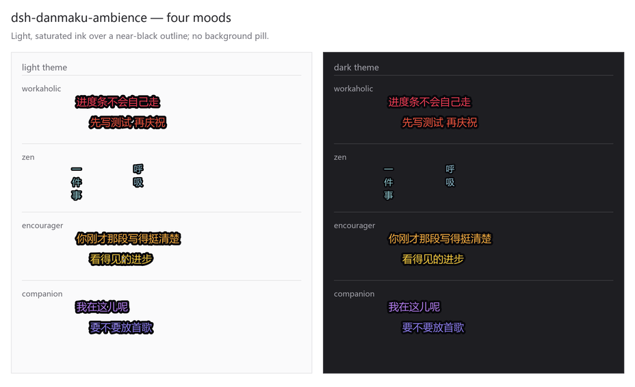

# dsh-danmaku-ambience

Ambient danmaku for the DeepSeek Harness Web UI. Short lines drift across the window in one of four moods, each with its own pacing, copy, color, and motion.



## Install

```sh
dsh plugin --profile <your-profile> add dsh-danmaku-ambience
```

Or open **Plugins → Add plugin** in the Web UI and paste the package name.

## Moods

| Mood | Pace | Motion | Tone |
|---|---|---|---|
| Workaholic | fast, ~5s per line | horizontal, quick, red | pushy, coach-like |
| Zen | very slow, ~30s | **vertical column**, falling, teal-gray | minimal, spacious |
| Encourager | moderate, ~11s | horizontal, warm yellow and green | warm, specific praise |
| Companion | low and steady, ~17s | horizontal, soft violet and blue | like a friend nearby |

Encourager is on by default after install.

## Usage

- **Capsule** at the bottom right shows the current mood. Click it to pick a mood (including Off) and adjust pace, opacity, and font size.
- **Settings → General → Danmaku** toggles the whole feature. Re-enabling returns to the mood you last used.

Preferences are stored in `localStorage` and survive a reload.

## How the text stays readable

Lines have no background pill. Each line is drawn in its mood hue with a near-black outline (`-webkit-text-stroke` plus `paint-order: stroke fill`) and a soft halo, so the copy stays legible over the white transcript, the gray sidebar, code blocks, and either theme. The worst ink-to-outline contrast across every hue is above 5:1.

Zen mode stacks one character per box rather than using `writing-mode: vertical-rl`, because vertical writing modes rely on Japanese glyph forms and misplace Chinese punctuation.

## Limitations

- The copy is a **fixed phrase pool** (14–42 lines per mood, per language). Which line appears, and where, is random; the text itself is not generated. The plugin does not read your conversation, so a line like "that paragraph you wrote is clear" is ambient encouragement, not a response to your actual work.
- A mood's pool cycles without repeating, but long sessions will revisit lines.
- Zen columns are drawn at a random horizontal position; they do not avoid the capsule in the corner.

## Development

The bundle is a plain ES module plus a browser client module; there is no build step.

```
package.json        manifest and dsh sections
cordis.patch.yml    inserts the plugin row
index.js            Host half (empty: the feature is browser-only)
client.js           all behaviour: moods, engine, capsule, settings row
locale/*.json       display metadata, UI strings, phrase pools
docs/DETAIL.md      Plugins page detail document
```

## License

MIT
